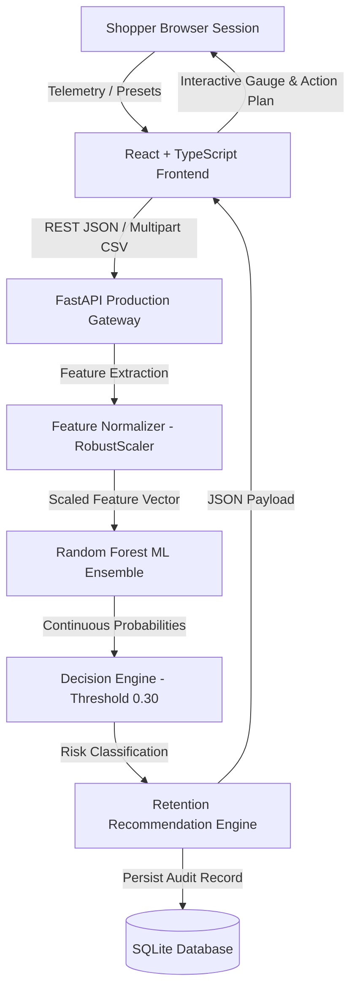

# 🛒 CartGuard ML: Big Data-Based E-Commerce Cart Abandonment Prediction & Intelligent Customer Retention System

[](https://python.org)
[](https://fastapi.tiangolo.com)
[](https://react.dev)
[](https://vitejs.dev)
[](https://scikit-learn.org)
[]()

> **Final Year College Capstone Project in Computer Engineering**  
> An end-to-end Machine Learning web application that predicts e-commerce cart abandonment in real time using clickstream telemetry and automatically triggers personalized customer retention interventions.

---

## 📌 Executive Summary

Cart abandonment accounts for an estimated **$18+ Billion in lost annual digital commerce revenue**, with average abandonment rates hovering between 65% and 75%. Traditional systems rely on delayed follow-up emails sent hours after a user has left the site. 

**CartGuard ML** solves this by:
1. Ingesting live session clickstream telemetry (session duration, views, cart additions, historic conversion rates).
2. Applying an imbalance-calibrated **Random Forest Classifier** operating at a 0.30 decision threshold to maximize **Recall (96.96%)**.
3. Returning real-time behavioral explainability (feature attribution drivers).
4. Generating automated, personalized **Intelligent Retention Recommendations** (exit-intent discounts, scarcity notifications, social proof badges, or frictionless checkout flows).

---

## 🏗️ Architecture & System Design



---

## 📊 Model Evaluation & Benchmarks

The model was trained and evaluated on 80,000+ eCommerce session events with stratified train/validation/test splits:

| Metric | Test Set Score | Description |
| :--- | :--- | :--- |
| **Recall (Sensitivity)** | **96.96%** | Successfully catches 97 out of 100 potential cart abandoners |
| **Precision** | **78.64%** | Minimizes false alarms to prevent unnecessary margin erosion |
| **F1-Score** | **86.84%** | Harmonic mean balancing recall and precision |
| **PR-AUC** | **86.47%** | Precision-Recall curve area under curve |
| **ROC-AUC** | **73.37%** | Area under receiver operator characteristic |

### Holdout Test Set Confusion Matrix

```
                 Predicted Converted    Predicted Abandoned
Actual Converted        100 (TN)               251 (FP)
Actual Abandoned         29 (FN)               924 (TP)
```

---

## 🚀 Quick Start (Running Locally)

### Prerequisites
- **Python 3.10+** (with `pip`)
- **Node.js v18+** & **npm**

### Option A: One-Click Startup (Windows)
Double-click `start_all.bat` in the project root. It will open two console windows and start both services:
- **Frontend Application:** [http://localhost:5173](http://localhost:5173)
- **FastAPI Interactive Docs:** [http://127.0.0.1:8000/docs](http://127.0.0.1:8000/docs)

### Option B: Manual Startup

#### 1. Start Backend
```powershell
cd backend
python -m uvicorn app.main:app --host 127.0.0.1 --port 8000 --reload
```

#### 2. Start Frontend
```powershell
cd frontend
npm run dev
```

---

## 🧪 Automated Integration Tests

Run the full end-to-end verification suite:
```powershell
python backend/tests/run_tests.py
```
**Test Coverage:**
- `GET /health`: Health and model loading verification
- `GET /api/model/metadata`: Model registry & test metrics check
- `POST /api/predict`: Real-time single cart inference & retention rules
- `POST /api/predict`: Pydantic input schema error handling (422 test)
- `POST /api/predict/csv`: Batch CSV upload & tabular parsing
- `GET /api/analytics/overview`: Aggregate analytics calculation
- `GET /api/predictions/history`: Database persistence & audit pagination

---

## 📂 Project Structure

```
├── artifacts/                     # Trained ML models and schemas
│   ├── model.joblib               # Serialized Random Forest Classifier
│   ├── scaler.joblib              # RobustScaler parameter state
│   ├── model_metadata.json        # Performance metrics & configuration
│   └── feature_schema.json        # Feature definitions & data types
├── backend/                       # Production FastAPI Application
│   ├── app/
│   │   ├── main.py                # App entrypoint, CORS, routers
│   │   ├── config.py              # Environment and path settings
│   │   ├── schemas.py             # Pydantic v2 validation models
│   │   ├── database.py            # SQLite WAL persistence layer
│   │   ├── services/
│   │   │   ├── model_service.py   # Model artifact loader & inference
│   │   │   ├── prediction_service.py # Feature mapping pipeline
│   │   │   └── recommendation_service.py # Retention rules engine
│   │   └── routers/
│   │       ├── predictions.py     # Predict endpoints (single, batch, CSV)
│   │       ├── analytics.py       # Statistics & feature importance
│   │       └── model.py           # Model metadata endpoint
│   ├── tests/
│   │   └── run_tests.py           # 7-step E2E integration test suite
│   └── requirements.txt           # Python dependencies
├── frontend/                      # React 19 + TypeScript + Vite UI
│   ├── src/
│   │   ├── components/
│   │   │   ├── Header.tsx         # Navigation & live system health
│   │   │   ├── OverviewTab.tsx    # Executive dashboard & KPIs
│   │   │   ├── PredictorTab.tsx   # Interactive simulator with personas & gauge
│   │   │   ├── BatchTab.tsx       # CSV drag-and-drop batch processor
│   │   │   ├── ModelHubTab.tsx    # Confusion matrix & feature bars
│   │   │   └── HistoryTab.tsx     # Filterable SQLite audit trail
│   │   ├── api.ts                 # Typed fetch client
│   │   ├── types.ts               # Shared TypeScript interfaces
│   │   └── index.css              # Glassmorphic dark design system
│   └── public/
│       └── sample_batch_input.csv # Downloadable sample batch dataset
├── notebooks/                     # Exploratory Data Analysis & Training
│   ├── preprocessing_pipeline.py  # Feature engineering transformations
│   ├── train_local.py             # Standalone local training script
│   └── cart_abandonment_training.ipynb # Google Colab training notebook
├── start_all.bat                  # One-click Windows startup script
├── run_backend.bat                # Dedicated backend launcher
└── run_frontend.bat               # Dedicated frontend launcher
```
